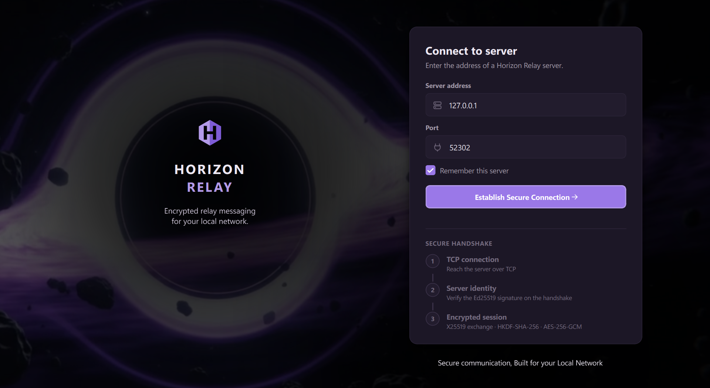
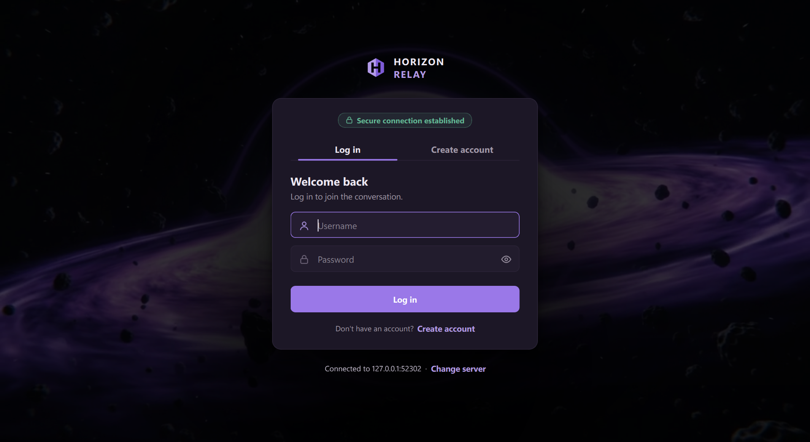
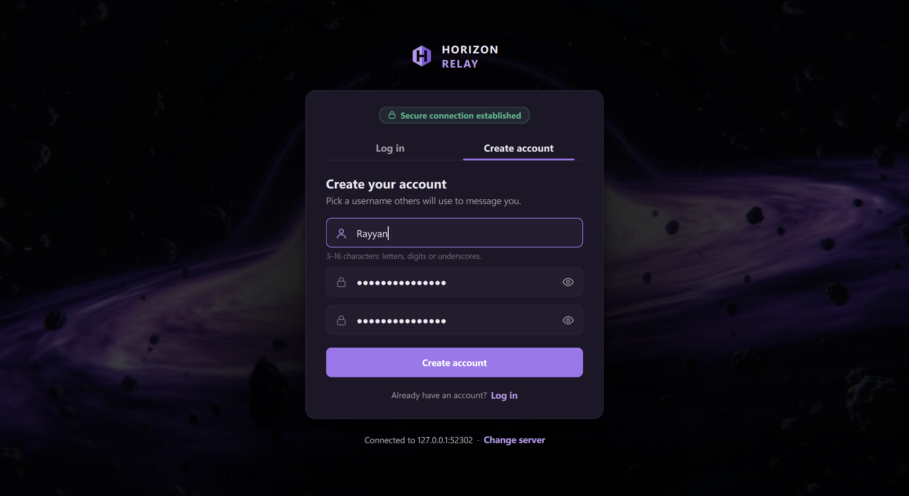
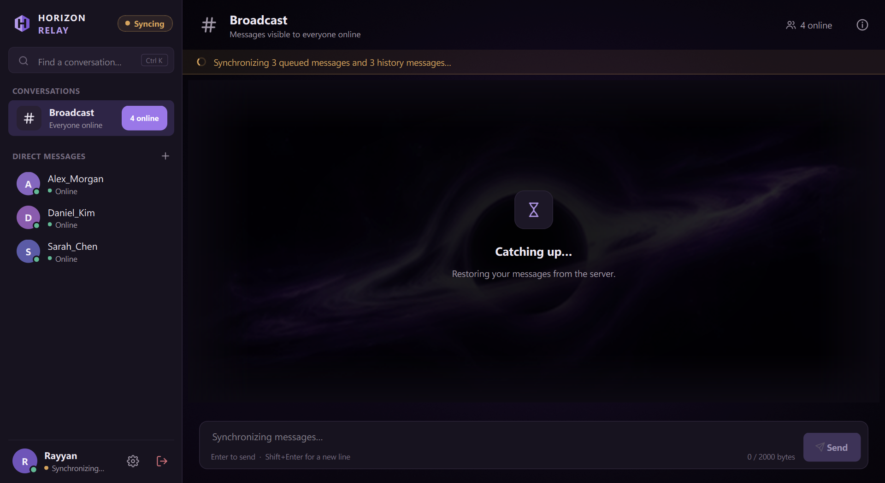
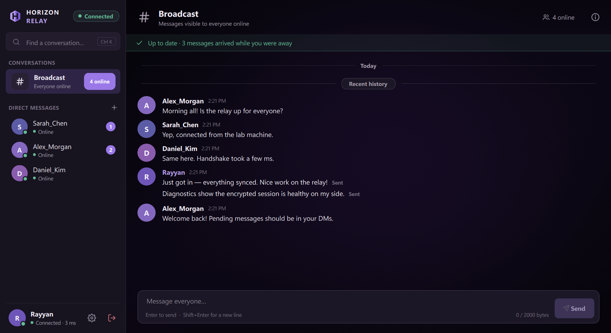
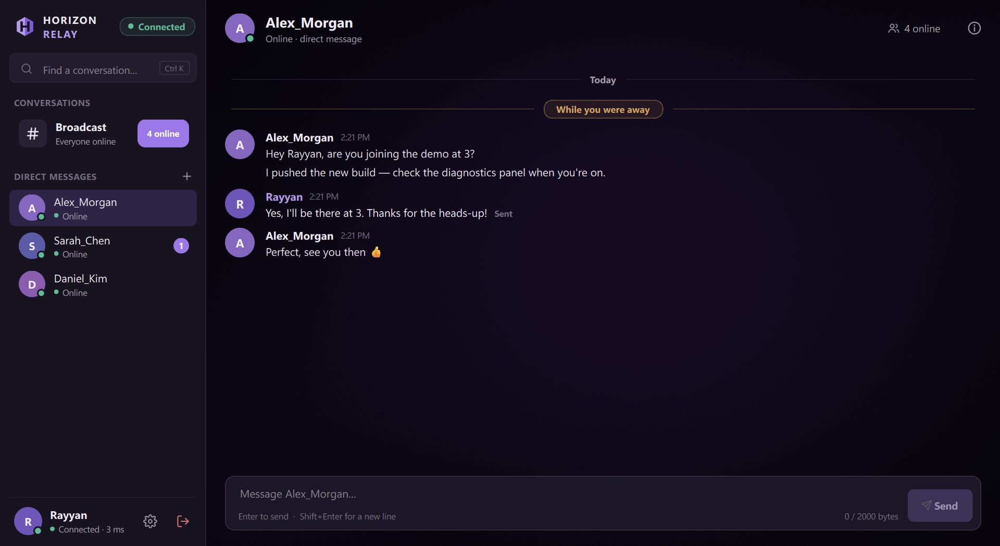
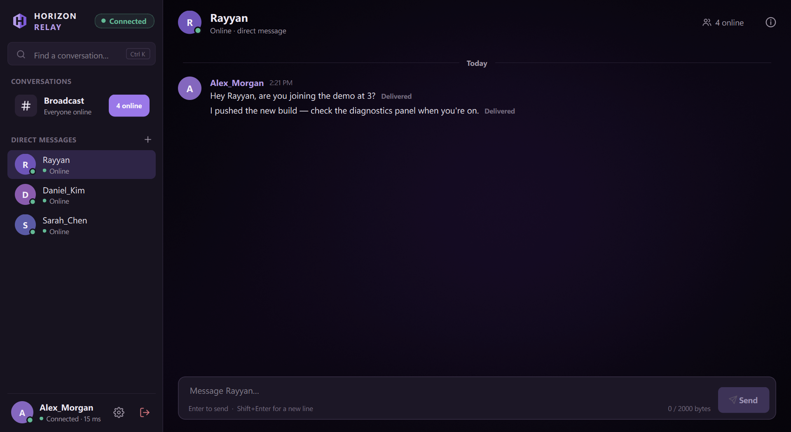
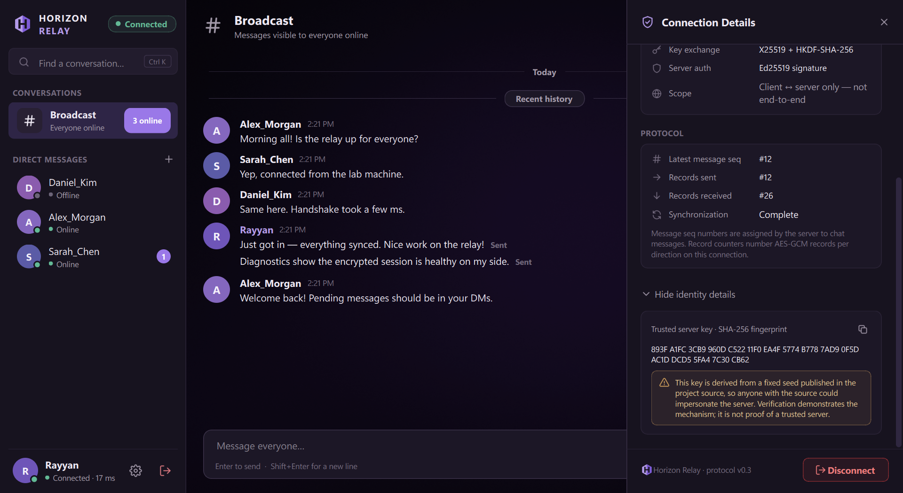
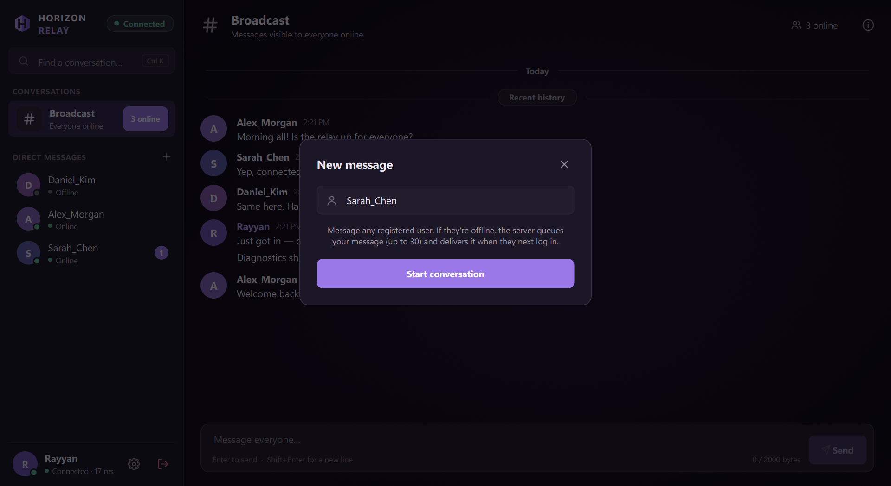

<div align="center">

# 🌌 HORIZON RELAY
### Encrypted Multi-Host TCP Chat Protocol & Desktop Client

[](https://python.org)
[]()
[]()
[]()
[](https://doc.qt.io/qtforpython-6/)

*A custom application-layer chat protocol built from scratch over raw TCP sockets—featuring authenticated elliptic-curve key exchange, replay-protected AES-256-GCM records, transactional offline synchronization, and a dark violet desktop interface.*



</div>

> **Security scope:** traffic is encrypted **between each client and the server** (no TLS, a custom
> handshake). The server decrypts messages to route, queue and store them, so this is **not
> end-to-end encryption**. See [Security notes](#-security-notes--known-limitations).

---

## ✨ Key Features

- **Custom Length-Prefixed Framing:** Solves TCP stream fragmentation and packet coalescing using a 4-byte unsigned big-endian length header (`[4B Length][Payload]`) with strict `16 KB` payload bounds.

- **Custom Cryptographic Handshake (No TLS):**
  - **X25519** ephemeral Diffie-Hellman key agreement per connection for forward secrecy.
  - **Ed25519** server signature over the full handshake transcript to detect Man-in-the-Middle (MitM) impersonation.
  - **HKDF-SHA-256** key derivation producing independent Client-to-Server (`C2S`) and Server-to-Client (`S2C`) keys and nonce prefixes.

- **Tamper & Replay-Proof Records:** Every post-handshake message is encrypted with **AES-256-GCM**, bound to Associated Authenticated Data (protocol ID, direction, frame length) and a strict monotonic **8-byte record counter** per direction, blocking bit-flipping, reflection and replay attacks. *(The record counter is separate from the server-assigned message `seq`.)*

- **Reliable Offline Store-and-Forward Sync:** Queues up to **30** private messages per offline recipient in SQLite and replays the last **30** relevant messages on login, using a two-phase batch acknowledgement (`SYNC_BEGIN` → `DELIVER` → `SYNC_END` → `SYNC_COMPLETE`) with `seq` deduplication, so messages are never lost on sudden disconnects.

- **Honest Delivery Status:** `Sending… → Sent / Queued → Delivered / Failed`. A queued message turns **Delivered** when the recipient's app acknowledges it (`DELIVERY_UPDATE`), even if the sender was offline at the time. No fake read receipts.

- **Zero-Plaintext Credential Storage:** Passwords are salted and hashed with **Argon2id**; usernames are validated (3–16 chars, `A–Z a–z 0–9 _`, `ALL` reserved) and unique case-insensitively.

- **Modern Purple-Themed Desktop GUI:** Non-blocking multi-threaded PySide6 client with live presence, broadcast and private DMs, a one-time *“While you were away”* divider, local message history, a **Connection Details** panel (handshake, cipher, RTT, `seq`, record counters, server fingerprint) and an animated black-hole login backdrop.

---

## 📦 Architecture Overview

The codebase is separated into **4 core modules** plus tooling:

- **`common/`** — Shared protocol rules and message builders, UTF-8 JSON validation, the 4-byte TCP framing engine, and the X25519/Ed25519/AES-256-GCM secure session layer.

- **`server/`** — Multi-threaded TCP listener (`0.0.0.0:5000`), per-client handshake state machine, SQLite persistence (Argon2id accounts, messages, sync batches), message router and synchronization coordinator.

- **`client/`** — Background socket workers (receive + send threads, so the UI never freezes), automatic sync acknowledgement and deduplication, RTT measurement, a per-account local store, and the PySide6 desktop GUI (`client/ui/`).

- **`tests/`** — Automated suites for stream fragmentation, cryptographic tamper/replay rejection, database queue caps, live end-to-end TCP flows, client state and delivery updates.

- **`tools/`** — `gui_e2e.py` (drives four real client windows against a live server and regenerates the screenshots) and `make_pingpong.py` (rebuilds the background video).

<details>
<summary><b>Project structure</b></summary>

```text
multi-host-chat-protocol/
├── common/
│   ├── framing.py            # [4B length][payload] frames, 16 KB limit
│   ├── protocol.py           # validation, limits, DELIVERY_UPDATE schema
│   └── secure_session.py     # handshake + AES-256-GCM records
├── server/
│   ├── main.py               # entry point: python -m server.main
│   ├── connection.py         # per-client thread + handshake state machine
│   ├── services.py           # auth, routing, presence, sync
│   └── storage.py            # SQLite (created on first run)
├── client/
│   ├── main.py               # entry point: python -m client.main
│   ├── network.py            # background TCP/crypto worker
│   ├── session.py            # Qt bridge: network events -> signals
│   ├── state.py              # conversations, statuses, dedup (no Qt)
│   ├── store.py              # local SQLite: history, statuses, notices
│   └── ui/                   # screens, components, dialogs, theme, logo
├── assets/backgrounds/       # black-hole video (source + ping-pong), images
├── tests/                    # milestone + client test suites
├── tools/                    # gui_e2e.py, make_pingpong.py
├── docs/screenshots/         # images used in this README
└── requirements.txt
```
</details>

---

## 🚀 Quick Start

A fresh download starts with **zero accounts and zero chats**. The server creates its database
on first launch, and each client keeps its own history on that computer.

### 1. Install Dependencies

Python **3.10 or newer** is required. From the project folder:

```bash
pip install -r requirements.txt
```

*(Equivalent to `pip install cryptography argon2-cffi PySide6`.)*

### 2. Start the Central Server

Run on the host machine (binds to all LAN interfaces on port `5000` by default):

```bash
python -m server.main --host 0.0.0.0 --port 5000
```

| Option | Default | Meaning |
|---|---|---|
| `--host` | `0.0.0.0` | Interface to listen on (`127.0.0.1` = this machine only) |
| `--port` | `5000` | TCP port |
| `--db` | `horizon_relay.db` | SQLite file (created automatically) |

> **LAN Deployment:** Check the server's local IPv4 address (`ipconfig` on Windows or `ip a` on Linux/macOS) and enter that IP in the client connection screen.

### 3. Launch the Desktop Client

Run on the same machine (`127.0.0.1`) or any laptop on the same local network:

```bash
python -m client.main
```

Optional: `--host 192.168.1.20 --port 5000` prefills the form, and `--connect` connects immediately.

Then **Create account → Log in → chat.** Registration never logs you in automatically.

### 4. Run Automated Verification Suites

```bash
python -m tests.test_milestone_1        # Framing & JSON protocol validation
python -m tests.test_milestone_2        # Handshake, MitM, bit-flip & replay security tests
python -m tests.test_milestone_3        # SQLite storage, 30-msg queue cap & sync crash recovery
python -m tests.test_milestone_4        # Live multi-client TCP sockets & RTT measurement
python -m tests.test_client_state       # Client dedup, ACK reconciliation, handshake stages
python -m tests.test_delivery_updates   # Queued -> Delivered, one-time "While you were away"
python -m tools.gui_e2e --offscreen     # Full GUI end-to-end run (4 clients) + screenshots
```

---

## 🖧 Running on Several Laptops

1. All laptops join the **same Wi-Fi/LAN** and have the project + dependencies installed.
2. On the server laptop, allow the port through the firewall (PowerShell **as Administrator**, once):

   ```powershell
   New-NetFirewallRule -DisplayName "Horizon Relay" -Direction Inbound -Protocol TCP -LocalPort 5000 -Action Allow
   ```

3. Start the server, note its IPv4 address, and enter it on every client.
4. Check reachability from a client: `Test-NetConnection <server-ip> -Port 5000` → `TcpTestSucceeded : True`.

> University/public Wi-Fi often blocks device-to-device traffic (“client isolation”). A **phone hotspot** is the easiest workaround.

---

## 🧾 Protocol Reference

Every frame is `[4-byte big-endian length][payload]`. Handshake payloads are plain UTF-8 JSON;
everything after the handshake is an encrypted record `[8B counter][AES-256-GCM ciphertext + 16B tag]`.

| Direction | Message types |
|---|---|
| Handshake | `CLIENT_HELLO` → `SERVER_HELLO` (signed) → `FINISHED` (client) → `FINISHED` (server) |
| Client → Server | `REGISTER`, `LOGIN`, `SEND {to, text}`, `PING {ts}`, `SYNC_COMPLETE {sync_id}`, `QUIT` |
| Server → Client | `REGISTER_OK`, `LOGIN_OK`, `USERS`, `JOIN`, `LEAVE`, `SYNC_BEGIN {sync_id, pending, history, updates}`, `DELIVER {seq, from, to, text, ts, source}`, `SYNC_END`, `SEND_ACK {seq, status}`, `DELIVERY_UPDATE {seq, to, status}`, `PONG`, `ERROR {code, reason, message}` |

**Login order:** `LOGIN_OK` → `USERS` → `SYNC_BEGIN` → pending `DELIVER`s → history `DELIVER`s →
`DELIVERY_UPDATE`s → `SYNC_END` → `JOIN` (broadcast). Live messages for a user who is mid-sync are
held until their `SYNC_COMPLETE`.

| Code | Reason | | Code | Reason |
|---|---|---|---|---|
| 400 | `BAD_FORMAT` | | 422 | `INVALID_USERNAME` |
| 401 | `UNAUTHORIZED` | | 429 | `QUEUE_FULL` |
| 403 | `ALREADY_LOGGED_IN` | | 501 | `UNKNOWN_TYPE` |
| 404 | `USER_NOT_FOUND` | | 502 | `AUTH_FAILED` |
| 409 | `USERNAME_TAKEN` | | 503 | `TEXT_TOO_LONG` (> 2000 UTF-8 bytes) |

### Delivery statuses

| Status | Meaning |
|---|---|
| Sending… | Request in progress |
| Sent | `SEND_ACK status=delivered`: handed to the recipient's active connection |
| Queued | `SEND_ACK status=queued`: recipient offline, stored on the server |
| Delivered | `DELIVERY_UPDATE`: the recipient's app received the queued message and acknowledged its sync batch |
| Failed | Error or transport failure (Retry available) |

None of these mean the message was *read*. If the sender is offline when delivery happens, the
update waits on the server and arrives in their next login sync.

---

## 🖥️ Using the Desktop Client

| Keys | Action |
|---|---|
| Enter / Shift+Enter | Send / new line |
| Ctrl+K | Search conversations (Enter opens, or starts a DM with a typed username) |
| Ctrl+N | New message to any registered user (offline users get it later) |
| Ctrl+I | Connection Details (handshake, cipher, RTT, `seq`, record counters, fingerprint) |
| Esc | Close panel / dialog, clear search |

**Where data lives**

| Data | Location |
|---|---|
| Server accounts & messages | `horizon_relay.db` next to where the server runs (or `--db`) |
| Client history, statuses, divider state | `%LOCALAPPDATA%\HorizonRelay\` (Windows), `~/.local/share/HorizonRelay/` (Linux/macOS); override with `HORIZON_RELAY_DATA_DIR` |

**Start completely fresh:** stop the server, delete `horizon_relay.db`, and delete the client data folder above.

---

## 🔍 Wireshark Traffic Inspection

To inspect the protocol live on the wire:

1. Open **Wireshark** and capture on your **Wi-Fi** interface (or **Loopback** adapter for localhost).

2. Apply the display filter:

   ```text
   tcp.port == 5000
   ```

3. Observe the plaintext `CLIENT_HELLO` / `SERVER_HELLO` key exchange (`[4B length][JSON]`), followed by opaque encrypted records (`[4B length][8B counter][ciphertext + 16B GCM tag]`) and TCP/application RTT metrics. Chat text never appears in clear on the wire.

---

## 🛡️ Security Notes & Known Limitations

1. **Not end-to-end encrypted.** The server decrypts, routes and stores message text by design.
2. **Public server identity seed.** The server's Ed25519 key is derived from `DEFAULT_SERVER_SEED` in `common/secure_session.py`. Anyone with the source can impersonate the server, so “identity verified” demonstrates the mechanism rather than proving trust. Fix for real use: generate the key on the server only and pin its public key in clients.
3. **Plaintext at rest.** Message text is stored unencrypted in the server's SQLite file and in each client's local history.
4. **Academic project.** The protocol has not been independently audited.

---

## 🧰 Troubleshooting

| Symptom | Fix |
|---|---|
| *Connection refused* | Server not running, or wrong IP/port |
| *Timed out* | Firewall on the server laptop, different networks, or client isolation (use a hotspot) |
| *Server identity could not be verified* | Client and server come from different versions of the code |
| Still image instead of the animated background | `pip install PySide6` (needs the Qt Multimedia add-on). To rebuild the video: `pip install imageio-ffmpeg` then `python -m tools.make_pingpong` |
| *This account already has an active session* | That account is logged in elsewhere; log out there first |

---

## 📸 Screenshots

| | |
|---|---|
| **Log in** <br>  | **Create account** <br>  |
| **Synchronizing on login** <br>  | **Broadcast** <br>  |
| **Private conversation (“While you were away”)** <br>  | **Queued → Delivered** <br>  |
| **Connection Details** <br>  | **New message** <br>  |

<div align="center">

💜💙

</div>
